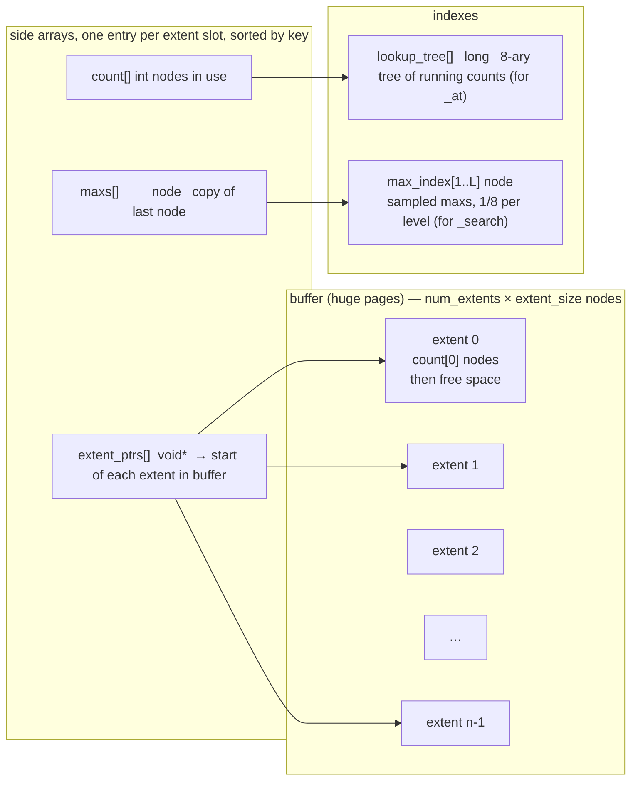
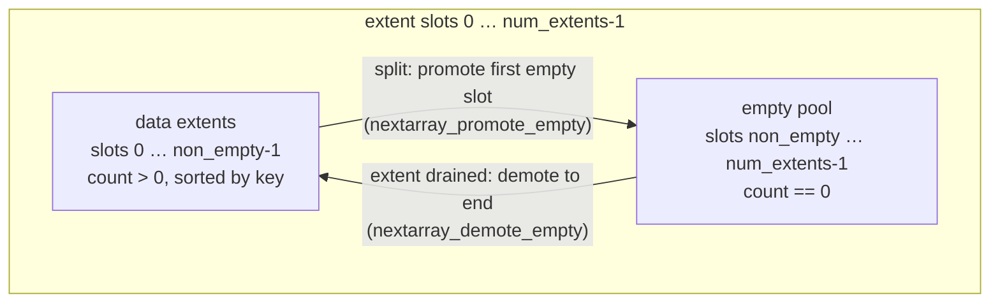
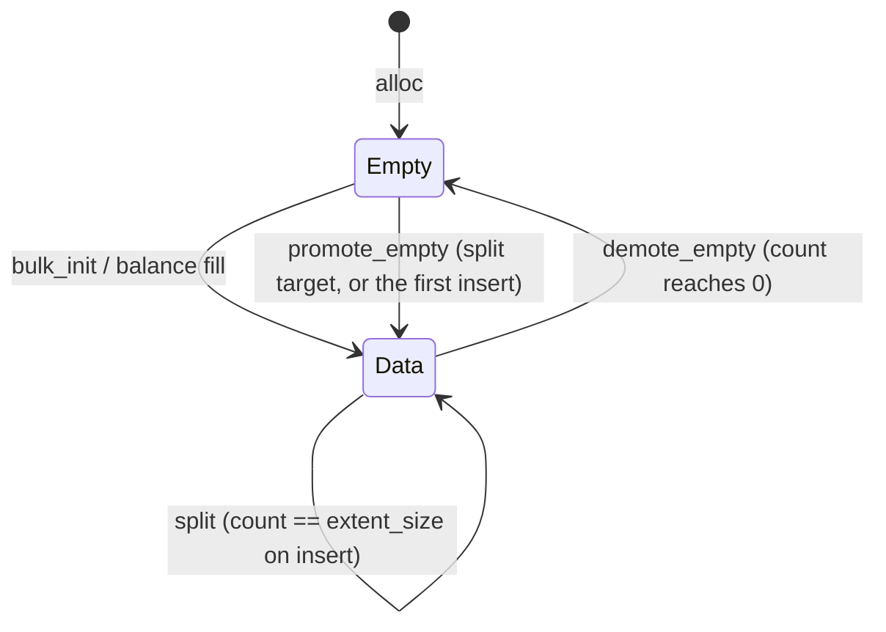
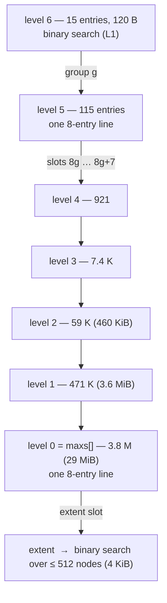
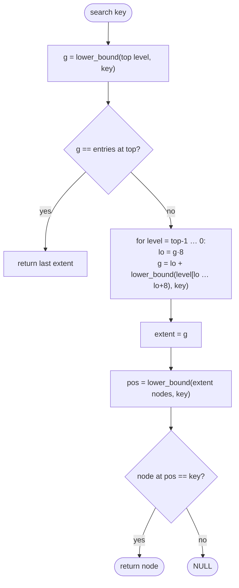
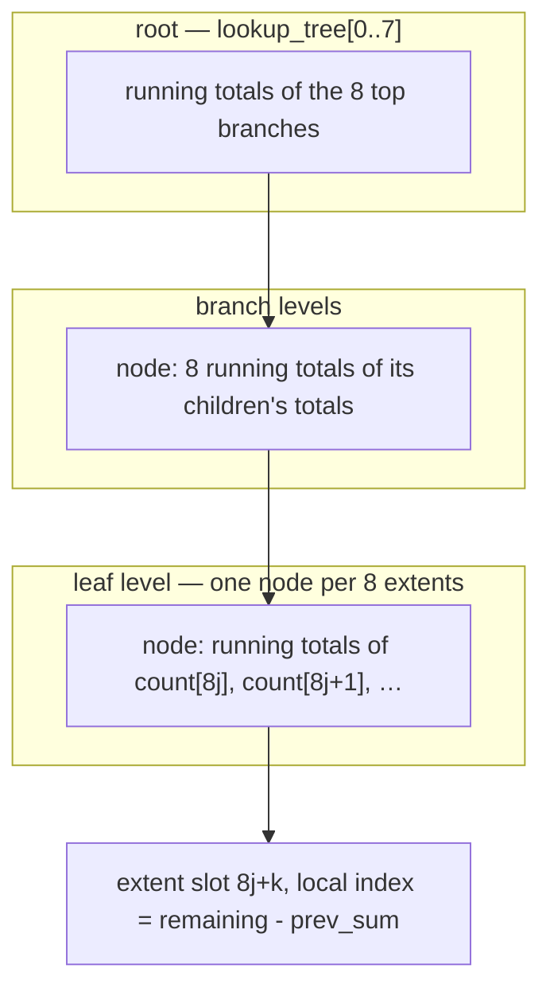
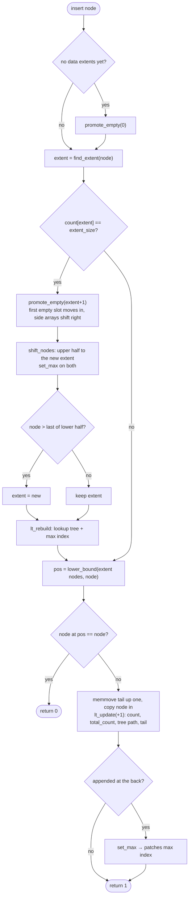
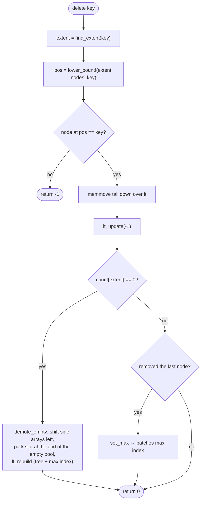

# NextArray Architecture

NextArray is a sorted array that has been cut into fixed-capacity pieces called
**extents** so that an insert or delete only shifts the nodes inside one extent
instead of the whole array. Everything else is a small side structure that
answers "which extent?" in a handful of cache lines: a multi-level sampled index over
the extents' max values for key lookups, and an 8-ary tree of running counts
for positional lookups.

The structure is generic over the node: it stores `node_size` bytes per node
and orders them with a caller-supplied `compare()`. The benchmarks use an
8-byte `Node { uint64_t value; }`.

| operation | path | cost model |
|---|---|---|
| `nextarray_search(key)` | max index → binary search in one extent | log₈(E) cache lines + ~2 DRAM round trips |
| `nextarray_at(i)` | lookup tree → offset in one extent | log₈(E) cache lines + 1 DRAM round trip |
| `nextarray_insert(node)` | search path + memmove inside the extent + count tree update | search + ½ extent memmove |
| `nextarray_delete(key)` | search path + memmove inside the extent + count tree update | search + ½ extent memmove |
| `nextarray_next(iter)` | sequential walk | streaming |

E is the number of non-empty extents (3.8 M at 1 G nodes).

## Memory layout

One large buffer holds every extent back to back. Every other array is indexed
by **extent slot**: slot `i` of each side array describes the same extent.
Extents are kept in key order by slot, so the side arrays are sorted too.



Sizes at the 1 G-node benchmark run (8-byte nodes, extent 512 nodes = 4 KiB,
overprovisioning 2.0):

| array | entries | bytes | where it lives during random ops |
|---|---|---|---|
| buffer | 2 G nodes in 4.19 M extents | 16 GiB | DRAM |
| extent_ptrs | 4.19 M | 32 MiB | DRAM |
| count | 4.19 M | 16 MiB | DRAM / L3 |
| maxs | 4.19 M | 32 MiB | DRAM / L3 |
| lookup_tree | 2.4 M nodes × 8 longs | 150 MiB | top levels L1/L2, leaves DRAM |
| max_index level 1 | 471 K | 3.6 MiB | L3 |
| max_index level 2 | 59 K | 460 KiB | L2 |
| max_index levels 3–6 | 7.4 K, 921, 115, 15 | 58 KiB total | L1/L2 |

Arrays of 2 MiB or more are allocated 2 MiB-aligned with `MADV_HUGEPAGE`, so
a random probe into them does not also pay a page walk whose page-table entry
is itself out in DRAM. Smaller arrays are 512-byte aligned.

## Extents

An extent is `extent_size` nodes of capacity (rounded so the extent is a
multiple of 512 bytes), of which `count[i]` are in use, sorted, packed at the
front. `maxs[i]` is a copy of the last node so the index never has to touch
the extent itself; the first node is simply `extent_ptrs[i]`.

Slots are split into a **data region** and an **empty pool**:



`non_empty = num_extents - num_empty_extents`. `nextarray_alloc` reserves 90 %
of the slots as `num_data_extents` for `bulk_init` to fill and leaves the rest
as room for splits.



A split happens when an insert lands in a full extent: the first empty slot is
promoted into the slot right after the full one (the side arrays shift right by
one, an O(E) memmove), the upper half of the nodes is moved over, and both
`maxs` entries are refreshed. Because slot order changed, the lookup tree and
the max index are rebuilt. Splits are rare in steady state: after `balance`
every extent is about 55 % full, so an extent absorbs ~230 inserts before
splitting.

## Key lookup: the max index

`nextarray_find_extent(key)` must return the first extent whose max ≥ key.
`maxs[]` is sorted, so a binary search works, but at 1 G nodes it is 29 MiB
and every probe is a DRAM miss. The max index stacks sampled copies on top:
level k holds the max of each group of 8 entries of level k-1 (level 0 is
`maxs` itself), and levels are added until the top has ≤ `SAMPLE_TOP` (64)
entries.



Walking down costs one cache line per level, and only the two bottom levels
and the extent itself are likely to miss L2. This is the same shape as the
lookup tree below, built from maxs instead of counts, and it replaced a
21-probe binary search over `maxs` that cost ~850 ns per search at 1 G nodes.



### Keeping the index current

| event | what changes | index work |
|---|---|---|
| insert/delete inside an extent, max unchanged | nothing | none |
| insert/delete at the end of an extent | `maxs[i]` | `set_max` patches level 1 if `i` is the last of its group of 8 (or the last extent), and so on up while that stays true |
| split, extent drained, bulk_init, balance | slot order or `non_empty` | `nextarray_lt_rebuild` rebuilds the lookup tree and then `nextarray_rebuild_max_index` rebuilds every level, O(E/7) |

## Positional lookup: the lookup tree

`nextarray_at(i)` needs the extent containing global index `i` and the offset
inside it. The lookup tree is an 8-ary tree of **running totals** over
`count[]`, stored as one flat `long` array with the root first and each level
contiguous after the previous one (`level_offset[]` is precomputed at alloc).



Each node is 8 longs = one cache line, which is exactly one AVX-512 register:
the descent compares all 8 running totals against the remaining index with one
`vpcmpgtq` and takes the trailing-zero count of the mask as the child position,
and a count update adds ±1 to the suffix of a node with one masked `vpaddq`.
Height is `ceil(log8(E)) + 1`; at 1 G nodes that is 8 levels and 2.4 M nodes.
These two functions carry `__attribute__((target("avx512f")))` so the project
Makefile's `-std=c99 -O2` build (no `-march=native`) still compiles them.

```mermaid
flowchart TD
    I([global index i]) --> Z{"i == 0 or i == total-1?"}
    Z -- yes --> HT([head / tail pointer])
    Z -- no --> L0["node = root, remaining = i"]
    L0 --> L1["mask = node[0..7] > remaining  (one vector compare)<br/>pos = tzcnt(mask); remaining -= node[pos-1]<br/>descend to child pos"]
    L1 --> L2{"leaf level?"}
    L2 -- no --> L1
    L2 -- yes --> L3["extent = leaf_idx·8 + position<br/>local = remaining - previous total"]
    L3 --> OUT([extent_ptrs[extent] + local·node_size])
```

Updating after an insert or delete is O(log E): add ±1 to the leaf entries at
and after the extent's position in its leaf, then to the entries at and after
the leaf's position in its parent, up to the root, one masked vector add per
level (`nextarray_lt_update`).

## Insert



The memmove averages half an extent (about 1.1 KiB for the default 512-node
extents) and is ~12 % of insert time; smaller extents trade that against a
taller lookup tree.

## Delete



## Bulk load and balance

```mermaid
sequenceDiagram
    participant B as benchmark
    participant NA as nextarray
    B->>NA: nextarray_alloc(max_nodes, extent_size, node_size, compare)
    Note over NA: sizes extents, allocates buffer + side arrays + indexes
    B->>NA: load nodes straight into na->buffer
    B->>NA: nextarray_bulk_init(count, sorted)
    Note over NA: qsort if unsorted, then deal count/num_data_extents nodes<br/>into each data extent back to front, set_max, lt_rebuild
    B->>NA: nextarray_balance()
    Note over NA: one left-to-right pass over extents more than 20% off target: push the excess to<br/>the right neighbour (promoting a fresh extent if that would overflow), or pull the shortfall<br/>from it (demoting the neighbour if drained); then set_max all, lt_rebuild
    B->>NA: search / at / insert / delete / next …
```

`bulk_init` writes nodes from the end of the sorted buffer into the last data
extent backwards, so it can read from the same buffer it is writing into
without overlap. `balance` brings any extent more than 20 % away from
`ceil(total / num_data_extents)` nodes back to that target, about 55 % of
capacity at overprovisioning 2.0; the tolerance stops a one-node imbalance
from cascading one node at a time down the whole array. Every node move in
both goes through `nextarray_shift_nodes`, which moves a run between two
neighbouring extents in either direction while preserving order.

## Iteration

`nextarray_next` walks `extent_ptrs[e] + idx` and steps to the next slot when
`idx == count[e]`, stopping at the first empty slot. Because data slots are
contiguous and sorted, this is a sequential scan of the data region.

## Invariants

- Data slots `0 … non_empty-1` have `count > 0`; slots after them have `count == 0`. An empty structure has no data slots; the first insert promotes one.
- Within the data region, `maxs[i]` is less than the first node of extent `i+1`: extents never overlap and are in key order.
- `maxs[i]` equals the last node of extent `i`.
- `max_index[k][g]` equals `max_index[k-1][min(8g+7, n_{k-1}-1)]`, with `max_index[0] = maxs`.
- Leaf entry `j` of the lookup tree equals the sum of `count[]` over the first `j+1` extents of that leaf; a branch entry is the sum of its first `j+1` children's totals. The root's last entry equals `total_count`.
- `head` and `tail` point at the first node of slot 0 and the last node of slot `non_empty-1`.

## Parameters

| name | where | default | effect |
|---|---|---|---|
| `extent_size` | `nextarray_alloc` / `-e` | 512 nodes | memmove cost per insert/delete vs index height; the sweep in `sweep.py` varies it |
| overprovisioning | benchmark `-o` | 2.0 | fraction of capacity in use after balance (1/2.0 ≈ 55 % after the 90 % data share) |
| `LOOKUP_NODE_SIZE` | `nextarray.h` | 8 | lookup tree fan-out; 8 longs is one cache line |
| `SAMPLE_GROUP` | `nextarray.c` | 8 | max index fan-out; 8 × 8-byte nodes is one cache line |
| `SAMPLE_TOP` | `nextarray.c` | 64 | top level size; binary search over ≤ 64 L1-resident entries |

## Measured cost at 1 G nodes

Xeon Platinum 8260, 5 M operations each, random keys. "Index" is the max
index, huge pages, single-search delete and precomputed level offsets; "SIMD"
adds the AVX-512 lookup-tree descent and update.

| op | original | + index | + SIMD tree |
|---|---|---|---|
| search | 847 ns | 639 ns | 634 ns |
| index (`_at`) | 207 ns | 183 ns | 158 ns |
| insert | 1.12 µs | 833 ns | 797 ns |
| delete | 1.29 µs | 903 ns | 876 ns |

At 16 M nodes, where the tree is cache resident, the SIMD descent takes `_at`
from 76 ns to 45 ns.

The remaining cost is memory latency: roughly two dependent DRAM round trips
inside the extent plus two or three in the bottom index levels, and the
structure runs at about 0.6 instructions per cycle. SIMD only paid off in the
lookup tree, whose nodes are plain `long`s and whose upper levels stay in
cache. Vectorizing the key searches would need a fixed key type and cannot
hide the misses; inlining the compare (the upper bound of that gain) measured
2 %. Branchless search, prefetching k-ary search and `-O3 -march=native` were
also measured and did not help.

## Known costs and limits

- A split or a drained extent shifts the side arrays (O(E) memmove, ~30 MiB each at 1 G) and rebuilds both indexes (O(E)). Rare after `balance`, but a pathological sequential insert pattern would hit it every ~230 inserts.
- Keys must be unique; `insert` returns 0 on a duplicate without inserting.
- `num_extents` must be at least 6, and 10 % of the slots are reserved as the empty pool regardless of workload.
- `nextarray_at` prints and exits on an empty structure; out-of-range indexes return NULL.
- The structure is single-threaded.

## Files

| file | role |
|---|---|
| `nextarray.h` | `nextarray_t`, iterator, API |
| `nextarray.c` | implementation, in sections: helpers (`lower_bound`, huge-page `alloc_array`), lookup tree (`nextarray_lt_*`), max index (`nextarray_*_max_index`, `set_max`, `find_extent`), extent slots (`promote_empty`, `demote_empty`, `shift_nodes`), API, setup, debug helpers |
| `benchmark.c` | timing driver, writes `nextarray-<timestamp>.json` for `../analysis` |
| `test.c` | functional tests against the sorted oracle files in `../data` |
| `sweep.py` | runs the benchmark over data sizes and extent sizes |
